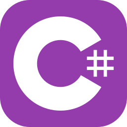
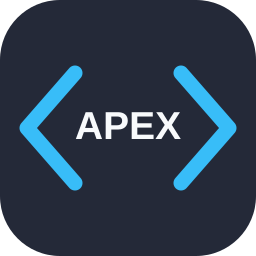
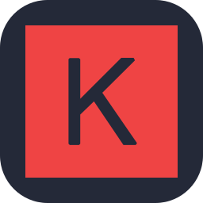
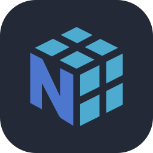
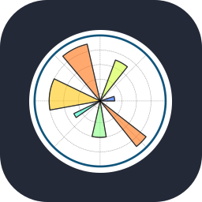
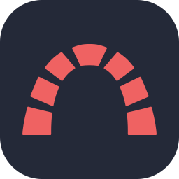
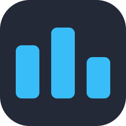
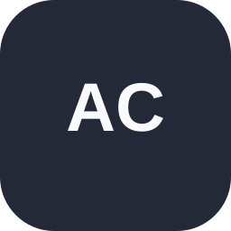

  
  
  

 

## 🧠 About Me

I build with Python, data, and machine learning at my core — and I'm currently expanding into enterprise development through BJIT Academy's **ERP, SAP & Salesforce** training track. I like working end-to-end: from data pipelines and models to backend APIs and enterprise workflows.

- 🚀 Currently training in **ERP / SAP / Salesforce development (Apex)** at BJIT Academy
- 🌱 Expanding beyond Python into **C#, Java, JavaScript, and .NET**
- 🧬 Long-term focus stays on **AI, Machine Learning & Data Science**
- 🔍 Exploring **NLP, Generative AI, and LLM-based applications**
- ⚔️ Practicing competitive programming and DSA
- 🎓 Aiming for a Master's abroad in AI/ML or Data Science down the line

 

## 🚀 Tech Stack

**Languages**

  
  
  
  
  
  
  

**Frameworks**

  
  
  

**Databases**

  
  

**Artificial Intelligence, Machine Learning & Data Science**

  
  
  
  
  
  
  
  

**Enterprise / CRM**

  
  

**Tools**

  
  
  
  
  
  
  
  
  
  
  

 

## 📊 GitHub Stats

 

## 📫 Connect With Me

  
  
  
  
  
  
  

